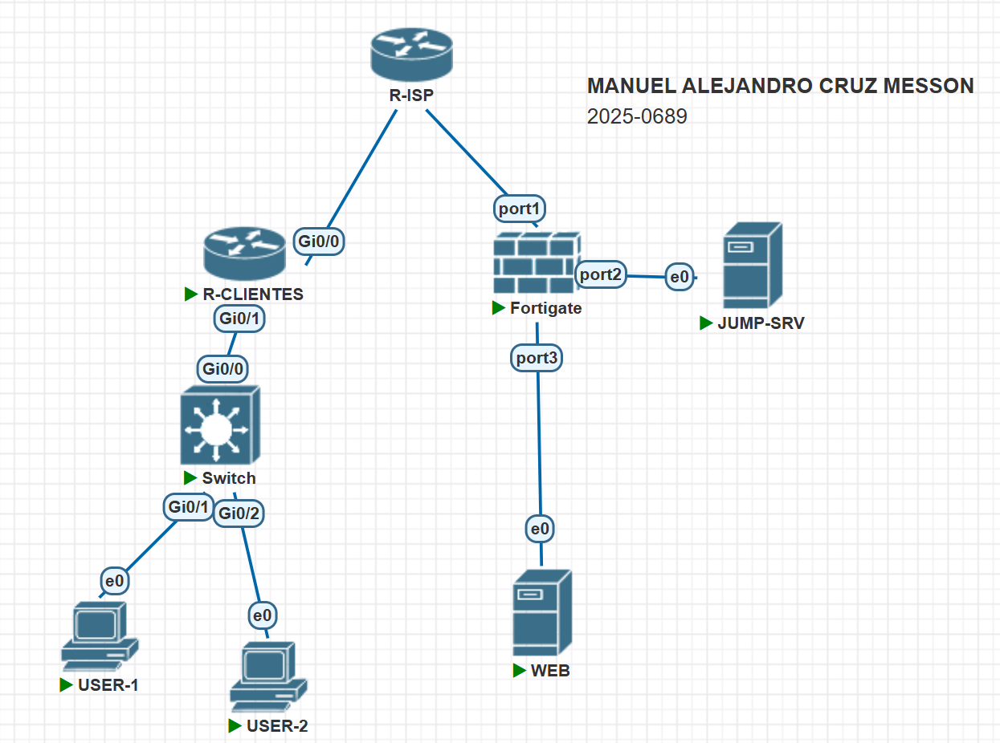

# Implementación de Acceso Remoto Seguro (SSL-VPN) con Jump Server y Microsegmentación Perimetral

> **Autor:** Manuel Alejandro Cruz Messón  
> **Matrícula:** 2025-0689  
> **Enlace del Video:** [Ver Demostración Técnica en YouTube](https://TU-ENLACE-DE-VIDEO-AQUI.com)

---

## 1. Propósito del Proyecto
Diseñar, implementar y auditar una infraestructura perimetral de acceso remoto seguro bajo el principio de mínimo privilegio (*Zero Trust / Least Privilege*), utilizando un firewall de próxima generación FortiGate administrado íntegramente por su interfaz gráfica (GUI) y equipos de red Cisco. 

La solución proporciona a los usuarios de la red LAN (VLAN 10) acceso remoto cifrado mediante un túnel SSL-VPN que se encuentra estrictamente confinado a un **Jump Server** (bastión) alojado en su propia zona de seguridad `/29`. Desde este bastión, y a través de un cliente web de aplicaciones remotas (**Apache Guacamole RemoteApp Web Client**), los usuarios acceden a los recursos internos de un **Web Server** alojado en una segunda red independiente `/29`. La comunicación inter-servidores se encuentra restringida a nivel de firewall para permitir de forma exclusiva los servicios de **HTTPS**, **SSH** y **RDP**, aplicando a su vez segregación estricta de perfiles para operadores de caja y administradores de sistemas.

---

## 2. Diagrama de la Topología

### Plan de Direccionamiento IP (Matrícula: 2025-0689)
| Segmento / Función | Dispositivo / Interfaz | Subred / CIDR | Máscara | Gateway | IP Asignada / Rango |
| :--- | :--- | :--- | :--- | :--- | :--- |
| **VLAN 10 (Usuarios)** | Cisco `Gi0/1.10` / Switch | `10.25.68.0/25` | `255.255.255.128` | `10.25.68.1` | `.2` – `.126` (DHCP Cisco) |
| **LAN Jump Server** | FortiGate `port2` | `10.25.68.128/29` | `255.255.255.248` | `10.25.68.129` | `10.25.68.130` (Estática) |
| **LAN Web Server** | FortiGate `port3` | `10.25.68.136/29` | `255.255.255.248` | `10.25.68.137` | `10.25.68.138` (Estática) |
| **Pool Virtual SSL-VPN** | FortiGate `ssl.root` | `10.212.134.200/24` | `255.255.255.0` | - | `10.212.134.200` – `.210` |
| **WAN / Enlace ISP** | FortiGate `port1` | `192.168.145.0/24` | `255.255.255.0` | `192.168.145.1` | `192.168.145.140` (WAN FortiGate) |
| **WAN Router Cisco** | Cisco `Gi0/0` | `192.168.145.0/24` | `255.255.255.0` | `192.168.145.1` | `192.168.145.150` (WAN Cisco) |

---

## 3. Descripción de lo Implementado

### 3.1. Infraestructura de Red y Enrutamiento (Cisco)
* **Router de Clientes (`R-CLIENTES`):**
  * **Interconexión WAN:** Interfaz física `GigabitEthernet0/0` configurada con la IP pública simulada `192.168.145.150/24`.
  * **Segmentación L3:** Subinterfaz `GigabitEthernet0/1.10` configurada con encapsulación 802.1Q en VLAN 10 y direccionamiento `10.25.68.1/25`.
  * **Servidor DHCP:** Configuración del pool `VLAN10_USERS` para entregar direccionamiento dinámico en el segmento `10.25.68.0/25` con gateway predeterminado en `10.25.68.1`.
  * **Enrutamiento:** Ruta estática por defecto (`0.0.0.0/0`) apuntando al siguiente salto hacia el enlace de transporte del ISP / FortiGate.
  * **Remoción de Túneles Previos:** Eliminación total de configuraciones residuales IPsec (Crypto Maps, Transform-Sets, políticas ISAKMP y ACLs) garantizando una arquitectura orientada a cliente-servidor sin dependencias de sitio a sitio.
* **Switch de Acceso (`Switch`):**
  * Enlace troncal en `GigabitEthernet0/0` conectado hacia el router y puertos de acceso en `GigabitEthernet0/1` y `GigabitEthernet0/2` asignados a la VLAN 10 para los equipos cliente (`USER-1` y `USER-2`).

### 3.2. Servidores Dedicados en Segmentos /29
* **Jump Server (`JUMP-SRV` - `10.25.68.130/29`):**
  * Servidor bastión implementado sobre Linux en el puerto físico `port2` del FortiGate.
  * Despliegue de **Apache Guacamole** (`guacd` + Apache Tomcat) en el puerto `8080`, proveyendo una plataforma cliente de acceso remoto web (RDP/SSH RemoteApp Web Client) accesible desde cualquier navegador sin instalación de software cliente en las estaciones finales.
  * Restricción granular de accesos mapeada en `user-mapping.xml` vinculando credenciales locales a perfiles específicos.
* **Web Server (`WEB` - `10.25.68.138/29`):**
  * Servidor de aplicaciones alojado en el puerto físico `port3` del FortiGate.
  * Alojamiento de la aplicación web interna **Sistema de Caja** mediante servidor Nginx bajo protocolo seguro HTTPS (puerto `443`) y HTTP (puerto `80`).
  * Servicio de administración remota por consola mediante OpenSSH en puerto `22`.
  * Servicio de escritorio remoto mediante XRDP sobre XFCE4 en puerto `3389`.

### 3.3. Seguridad Perimetral y Reglas de Tráfico (FortiGate NGFW - 100% GUI)
* **Gestión de Red y Retorno de Rutas:**
  * Creación de interfaces de Capa 3 independientes para la WAN (`port1`), LAN del Jump Server (`port2`) y LAN del Web Server (`port3`).
  * Inyección de ruta estática de retorno hacia la subred de clientes `10.25.68.0/25` a través de la IP `192.168.145.150` (`port1`) para asegurar la bidireccionalidad de las sesiones SSL-VPN.
* **Servicio SSL-VPN de Acceso Remoto:**
  * Configuración del demonio SSL-VPN en el puerto `10443` sobre la interfaz `port1`.
  * Portal SSL con **Split Tunneling estricto**, inyectando exclusivamente la ruta hacia el Jump Server (`10.25.68.130/32`).
* **Políticas de Firewall:**
  * **Acceso Permitido a Bastión:** Política que permite el tráfico desde la interfaz virtual `ssl.root` hacia `port2`, con destino único al objeto `HOST_JUMP_SERVER` (`10.25.68.130`).
  * **Aislamiento Explícito del Web Server:** Política en acción `DENY` con registro de eventos (*log violation*) que rechaza categóricamente cualquier paquete proveniente del túnel `ssl.root` hacia el objeto `HOST_WEB_SERVER` (`10.25.68.138`).
  * **Control Inter-Servidores (Jump -> Web):** Política que autoriza el tráfico saliente desde `port2` hacia `port3` filtrando de manera exhaustiva para permitir exclusivamente los objetos de servicio: **HTTPS (443)**, **RDP (3389)** y **SSH (22)**. Todo otro puerto (HTTP, FTP, ICMP ping) es descartado.

### 3.4. Control de Acceso y Segregación de Usuarios en Jump Server
* **Usuario Sin Privilegios (`usr_caja`):**
  * Destinado al personal de caja y operaciones.
  * Publicación exclusiva de la conexión web hacia el **Sistema de Caja**.
  * Restricción total: no tiene enlaces, perfiles ni visibilidad a terminales SSH ni escritorios RDP.
* **Usuario Con Privilegios (`usr_admin`):**
  * Destinado al personal de soporte e ingeniería TI.
  * Publicación de tres servicios esenciales:
    1. **Sistema de Caja:** Acceso HTTPS/Web al aplicativo comercial.
    2. **Consola SSH (PuTTY Web):** Shell interactiva hacia el servidor web (`10.25.68.138:22`).
    3. **Escritorio Remoto RDP:** Sesión gráfica interactiva hacia el servidor web (`10.25.68.138:3389`).

---

## 4. Inventario de Objetos Creados en FortiGate (GUI)

Esta sección documenta los componentes configurados desde la interfaz web del firewall de acuerdo con las directrices de entrega.

---

### A. Interfaces Físicas de Red (`Network > Interfaces`)

* **`port1` (WAN):** IP `192.168.145.140/24`, acceso administrativo HTTPS/SSH/PING habilitado.
* **`port2` (LAN_JUMPSERVER):** IP `10.25.68.129/255.255.255.248` (`/29`).
* **`port3` (LAN_WEBSERVER):** IP `10.25.68.137/255.255.255.248` (`/29`).

---

### B. Tabla de Enrutamiento Estático (`Network > Static Routes`)

| Destino / Subred | Gateway | Interfaz | Estado | Propósito |
| :--- | :--- | :--- | :---: | :--- |
| `10.25.68.0/25` | `192.168.145.150` | `port1` | Enabled | Ruta de retorno hacia los clientes de la VLAN 10. |

---

### C. Objetos de Red y Servicios (`Policy & Objects > Addresses`)

| Nombre del Objeto | Tipo | IP / Máscara | Propósito en la Topología |
| :--- | :---: | :--- | :--- |
| **`HOST_JUMP_SERVER`** | Subnet | `10.25.68.130/32` | Host único del Jump Server en `port2`. |
| **`HOST_WEB_SERVER`** | Subnet | `10.25.68.138/32` | Host único del Web Server en `port3`. |
| **`NET_VLAN10_USERS`** | Subnet | `10.25.68.0/25` | Red de usuarios conectados al router Cisco. |

---

### D. Ajustes de SSL-VPN y Portal (`VPN > SSL-VPN`)

* **Portal `PORTAL_JUMP_ONLY`:** Modo túnel activo, Split Tunneling habilitado enrutando exclusivamente a `HOST_JUMP_SERVER`.
* **SSL-VPN Settings:** Escucha en `port1`, puerto `10443`, mapeo del grupo `GRP_VPN_USERS` asociado al portal.

---

### E. Políticas de Firewall (